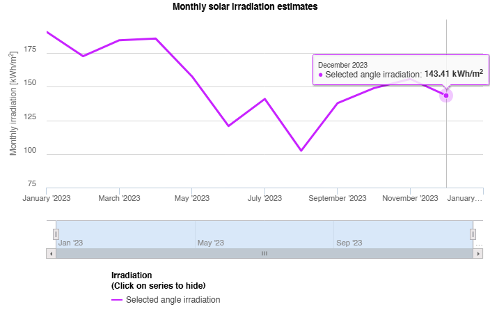

# PV System Sizing for a Stand-alone Household System

Design of a stand-alone solar PV system (PV array, battery bank, charge regulator, inverter) for a household in **Debidwar, Cumilla, Bangladesh** (23.6004° N, 90.9881° E).

Course project for **EEE 4111 – Renewable Energy**, Barishal Engineering College (submitted 26 Oct 2024).

## Live calculator

`index.html` is a static page that generalizes this project: enter your own appliances, site irradiation and component choices, and it sizes the array, battery bank, regulator and inverter with the same six-step method, showing every calculation. It runs entirely in the browser (no build step, no dependencies).

Once GitHub Pages is enabled, it is served at `https://<your-username>.github.io/pv-system-sizing/`.

Additions beyond the original equations (all default to the report's behavior): an optional extra-loss factor, battery unit count, a safety margin for regulator and inverter, a month-by-month coverage check, and a more conservative battery formula.

## Results

| Parameter | Value |
|---|---|
| Daily load | 31.26 kWh/day |
| Module tilt (south-facing) | 23° |
| Design peak sun hours (worst month, Aug 2023) | 3.30 h/day |
| Required PV energy | 45.30 kWh/day |
| Installed peak power | 13.73 kWp |
| System voltage | 48 V |
| Modules (50 Wp): 4 in series × 70 strings | 280 |
| Array area | 112 m² |
| Battery bank (5 days autonomy, 70 % DoD) | 4419 Ah @ 48 V |
| Regulator input current | 286.04 A |
| Inverter output | 5.906 kW (≈123 A at 48 V) |

## Method

1. Define load, location and tilt angle
2. Get solar irradiation for the site from [PVGIS](https://re.jrc.ec.europa.eu/pvg_tools/en/#PVP) and pick the worst month
3. Choose the system configuration (stand-alone, battery-backed, AC loads)
4. Compute installed power using efficiencies η_cable = 95 %, η_reg = 95 %, η_bat = 80 %, η_inv = 95 % (combined ≈ 0.69)
5. Compute number of modules and area
6. Size battery, regulator and inverter

Key formulas:

```
P_PV   = Load / (η_cable · η_reg · η_bat · η_inv)
P_peak = P_PV / PSH
N_s    = V_DC / V_module,   N_p = P_peak / (P_module · N_s)
C_B    = n_days · Load · η_cable / (V_DC · DoD)
```

## Figure



*Monthly irradiation at 23° tilt, 2023 (source: PVGIS © European Union).*

## Repository layout

```
├── index.html   (live calculator, served by GitHub Pages)
├── data/        loads.csv, irradiation.csv
├── src/         pv_sizing.py  (reproduces all results)
├── figures/     PVGIS irradiation chart
├── docs/        Assignment_01.docx (full report)
└── README.md
```

## Run

```bash
python3 src/pv_sizing.py
```

No external dependencies (Python 3.8+).

## Reference

1. M. A. A. Mamun et al., "Determining the optimum tilt angle and orientation for photovoltaic (PV) systems in Bangladesh," *2017 2nd ICEEE*, Rajshahi, IEEE, 2017, doi: 10.1109/CEEE.2017.8412910.
2. PVGIS © European Union, https://re.jrc.ec.europa.eu/pvg_tools/en/#PVP

## Author

Kazi Nazmul Hasan, Dept. of EEE, Barishal Engineering College (Batch EEE-03)
